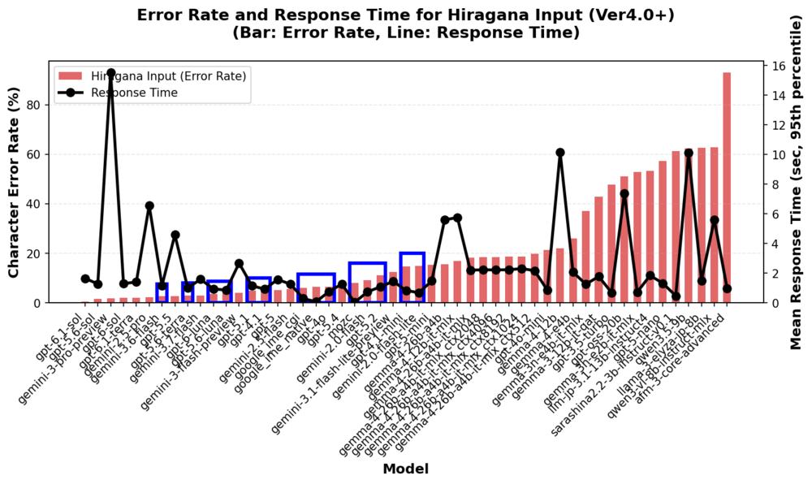
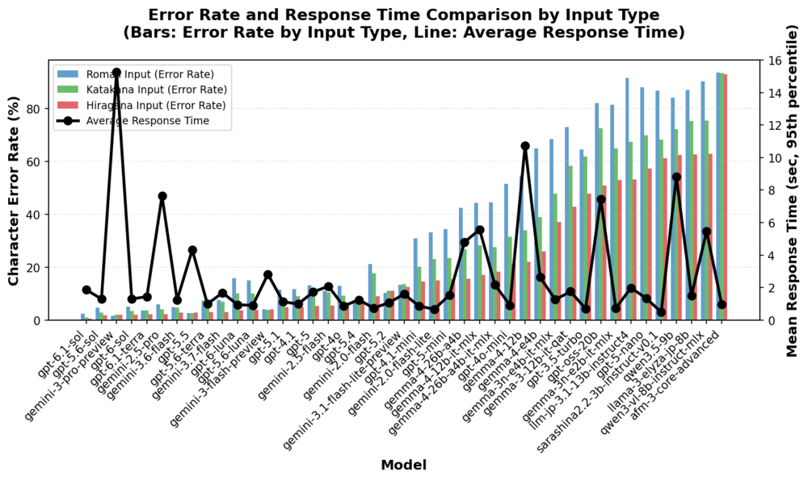
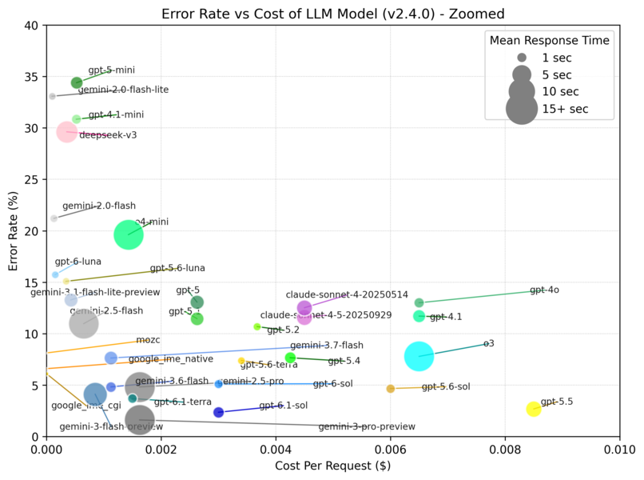

# GPT-6.1 Terra 日本語変換ベンチマーク（Issue #198）

## 結論

**3方式各200件の計測が完了。GPT-6.1 TerraはGPT-6.1 Solより高速・低価格だが、CERではSolに及ばない。** ローマ字入力ではGPT-6 SolよりCERが低い一方、応答は約0.14秒遅い。ひらがな入力ではGPT-6 SolよりCERと応答時間がわずかに劣るが、完全一致率は88%と、GPT-6 Solの83.5%より高かった。単一の精度指標だけで優劣を断定しない。

ひらがな入力で精度を最優先するなら、保存結果ではGPT-6.1 Sol（CER 0.55%、完全一致95%）が優位。費用を抑えつつ約1.4秒で変換したい場合はTerraが候補になる。GPT-5.6 TerraよりCER・完全一致率は改善したが、応答は遅い。運用前には実入力でも確認する。

## 計測結果

計測日時は **2026-10-29 07:17:33〜07:32:52（日本時間）**。ウォームアップ6回を含む606回すべて成功し、再試行0、空出力0、終了理由はすべて `stop`。推論トークン・キャッシュ入力トークンも0だった。

| 入力方式 | 件数 | CER | 完全一致 | 全件平均 | p95以下平均 | 中央値 | p95 |
|---|---:|---:|---:|---:|---:|---:|---:|
| ローマ字 | 200 | 3.70% | 146/200（73%） | 1.489秒 | 1.464秒 | 1.479秒 | 1.872秒 |
| ひらがな | 200 | 2.20% | 176/200（88%） | 1.459秒 | 1.408秒 | 1.415秒 | 1.986秒 |
| カタカナ | 200 | 3.68% | 158/200（79%） | 1.535秒 | 1.461秒 | 1.466秒 | 2.121秒 |

以下の比較表の時間は **p95以下の平均**。過去結果も保存JSONから同じ関数で再集計している。

| モデル | ローマ字 CER / 時間 | ひらがな CER / 時間 | ひらがな完全一致率 | 固定トークン数での概算費用/回 |
|---|---:|---:|---:|---:|
| GPT-6.1 Terra（none） | 3.70% / 1.46秒 | 2.20% / 1.41秒 | 88.0% | $0.0015 |
| GPT-6.1 Sol（low） | 2.36% / 2.08秒 | 0.55% / 1.66秒 | 95.0% | $0.0030 |
| GPT-6 Sol（none） | 5.11% / 1.32秒 | 2.01% / 1.31秒 | 83.5% | $0.0030 |
| GPT-5.6 Terra（none） | 7.39% / 0.99秒 | 2.99% / 1.01秒 | 78.5% | $0.0034 |

全指標・カタカナを含む比較は [集計JSON](summary.json) を参照。比較費用は入力500・出力200トークンを仮定した値であり、各モデルの実請求額ではない。特にSolのlow推論分は実使用量で変動する。







## 目的・条件

既存のAJIMEE-Bench JWTD_v2/v1の200例を変更せず、ローマ字・ひらがな・カタカナの3方式で漢字変換品質と応答速度を比較する。各方式にウォームアップ2回を加え、本計測は606リクエスト。疎通確認9リクエストは別に保存する。プロンプトは既存の `sumibi_typical_convert_client.py` と同じ。

- モデル: `gpt-6.1-terra`（previewの付かないモデルID）
- 接続先: `https://api.openai.com/v1/chat/completions`
- `reasoning_effort=none`、`verbosity=low`、`temperature=1.0`、`n=1`
- `service_tier=default`（Standard）、SDK自動再試行0回
- 公式仕様・料金確認: 2026-10-29
- 実行環境: macOS 27.0.1 / arm64、Python 3.9、OpenAI SDK 2.28.0、Levenshtein 0.27.1、matplotlib 3.9.4、numpy 2.0.2
- [モデル仕様](https://developers.openai.com/api/docs/models/gpt-6.1-terra) / [公式料金](https://developers.openai.com/api/docs/pricing)

GPT-6.1 Solの保存結果は `low`、GPT-6 Sol・GPT-5.6 Terraは `none` で取得されている。日時・環境も異なる過去結果との参考比較であり、モデル単体の差を厳密に分離した評価ではない。

## 再現方法

依存関係・評価データの配置は [ベンチマーク手順](../README.md) に従う。以下はリポジトリルートから実行する。

```sh
python3 -m unittest discover -s benchmark -p 'test_gpt_6_1_*settings.py'
# 認証キーはmacOSキーチェーンのapi.openai.com / apikeyから読み、表示・保存しない。
python3 benchmark/run_gpt_6_1_terra.py --key-source keychain --limit 1 --output-dir /tmp/terra-smoke-new
python3 benchmark/run_gpt_6_1_terra.py --key-source keychain --output-dir /tmp/terra-full-new
```

環境変数のキーを使う場合は `OPENAI_API_KEY` を設定し、`--key-source environment` を指定する。継承された他社プロバイダーの接続設定は使用せず、公式OpenAI接続先に限定する。

`--mode` は `all`（既定）/ `romaji_direct_input` / `hiragana_input` / `katakana_input`、`--limit` は各方式の評価件数。常に各方式の先頭例でウォームアップ2回を行う。既存出力があれば上書きせず停止する。途中失敗時は取得済みJSONと安全な監査記録を残して停止し、自動再試行・自動再開はしない。再実行前に既存結果と追加費用を確認する。

## 保存ファイル・統計

- 正式な結果: [ローマ字](../result_ver2.4.0/gpt-6.1-terra.json) / [ひらがな](../result_ver2.4.0/gpt-6.1-terra_hiragana.json) / [カタカナ](../result_ver2.4.0/gpt-6.1-terra_katakana.json)
- [本計測の監査記録](full/gpt-6.1-terra_run.json) / [疎通確認の監査記録](smoke/gpt-6.1-terra_run.json) / [集計JSON](summary.json)
- `full/gpt-6.1-terra*.json`: 全件の取得結果・監査記録
- `smoke/gpt-6.1-terra*.json`: 各方式1件とウォームアップの疎通確認
- `gpt-6.1-terra_run.json`: 実行日時、設定、データ・クライアントのSHA-256、呼び出しごとのトークン使用量・応答モデル・終了理由・参考費用。ウォームアップを含む。

CERは既存の集計と同じく各例のCERを1で上限処理して平均し、完全一致率は正解候補のいずれかとの完全一致で評価する。全件平均応答時間と95パーセンタイル以下の平均を区別する。既存の比較図では後者を使用している。ウォームアップは品質・遅延集計から除くが、費用には含める。

結果JSONの `henkan_text` と `surrounding_text` は既存形式を維持した元のローマ字表記であり、ひらがな・カタカナ方式の実際の送信本文ではない。送信本文は元データと方式別コンバーターで再現する。

集計のみ再実行する場合は `python3 benchmark/issue198/summarize.py`。APIは呼ばず、正解候補の順序が比較モデル間で一致することと、3方式各200件の完了を確認して集計する。

## 費用の扱い

本計測606回の実使用量は **入力309,869・出力12,891トークン**。参考費用は **$0.374324**（うち評価600件$0.370184、ウォームアップ6回$0.004140）。疎通確認9回$0.006210を加え、今回の合計615回では **$0.380534** だった。平均出力は約21トークンで、事前概算の200トークンより短かったことが費用差の主因。

通常の短文・Standard料金（入力$1、キャッシュ入力$0.05、出力$5／100万トークン）で、APIが返した `usage` から参考費用を計算する。推論トークンがある場合も `completion_tokens` に含めて計算する。税・為替・使用量不明の失敗試行などは含まず、請求明細そのものではない。特別なキャッシュ保持・書き込み設定は指定しない。

グラフ上の費用は既存モデルと比較するため入力500・出力200トークンを仮定した **$0.0015／変換** を使い、今回の実測使用量による費用とは区別する。600件とウォームアップ6回の事前概算は$0.909だった。
