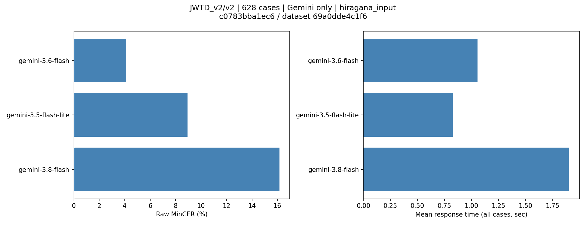
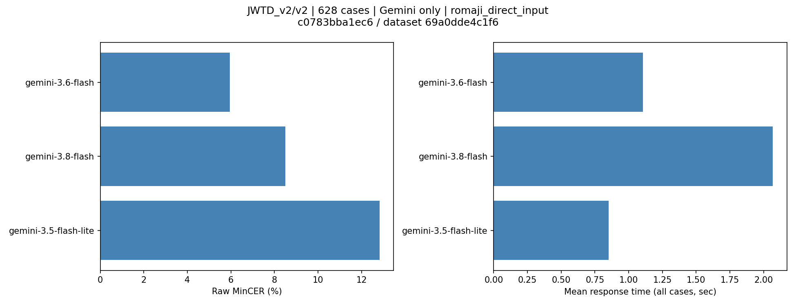
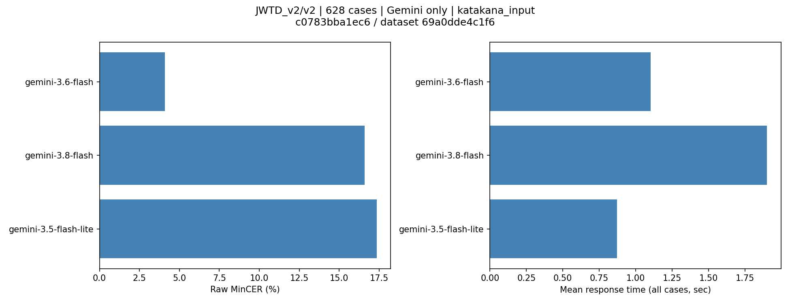

# JWTD_v2/v2・628件・Geminiのみ — 計測結果

## 現時点の結論

Gemini 3.5 Flash-Lite・3.6 Flash・3.8 Flashの3方式全件計測が完了した。**今回の3モデルでは3.6 Flashが全入力方式で最も低い平均MinCERだった。3.8 Flashは完全一致率が最も高い一方、説明・候補列挙などが付いた一部の長い出力により平均MinCERが悪化した。** IME用途では単に正解する頻度だけでなく、変換文以外を挿入しない安定性も考慮する必要がある。

**残りのGeminiモデルのv2再計測はまだ未実施。全対象の推奨順位は未確定で、Issue #205全体は未完了。** 旧v1のランキングやスコアとは混ぜない。計測時刻とモデル固有の推論条件は異なるため、同時刻・同じ思考量の厳密な統制実験とはしない。

### v2全628件・3モデル比較

| 入力方式 | モデル | MinCER | 完全一致率 | 全件平均 |
|---|---|---:|---:|---:|
| ローマ字 | 3.5 Flash-Lite | 12.82% | 37.42% | 0.851秒 |
| ローマ字 | 3.6 Flash | 5.95% | 55.10% | 1.106秒 |
| ローマ字 | 3.8 Flash | 8.51% | 67.99% | 2.068秒 |
| ひらがな | 3.5 Flash-Lite | 8.93% | 53.50% | 0.828秒 |
| ひらがな | 3.6 Flash | 4.11% | 66.08% | 1.055秒 |
| ひらがな | 3.8 Flash | 16.15% | 77.39% | 1.902秒 |
| カタカナ | 3.5 Flash-Lite | 17.34% | 45.86% | 0.870秒 |
| カタカナ | 3.6 Flash | 4.10% | 65.29% | 1.103秒 |
| カタカナ | 3.8 Flash | 16.60% | 75.16% | 1.900秒 |

3.6のひらがな4.11%とカタカナ4.10%は僅差で、信頼区間も重なる。入力方式の優劣をこの差だけで断定しない。[3モデルの集計JSON](summary-3models.json)に全統計・タグ・domain・出典別の内訳を保存した。[前段階の2モデル集計](summary-2models.json)も保持している。

## Gemini 3.8 Flashの詳細

2026-11-01 10:15:37〜11:18:33（日本時間）に1,890回を実行、HTTPエラー0・途中再開なし。返却モデルは全件`gemini-3.8-flash`。`reasoning_effort=low`、temperature=1.0、SDK再試行0、タイムアウト120秒。左文脈・プロンプト・文字種変換・評価データは他2モデルと同じ。

| 入力方式 | 完全一致 | 幅正規化完全一致率 | 中央値 | p95 | p95以下平均 | 最大 | ブロック／空出力 |
|---|---:|---:|---:|---:|---:|---:|---:|
| ローマ字 | 427/628 | 72.61% | 1.936秒 | 2.931秒 | 1.928秒 | 21.389秒 | 3 / 3 |
| ひらがな | 486/628 | 79.30% | 1.846秒 | 2.609秒 | 1.836秒 | 4.437秒 | 0 / 0 |
| カタカナ | 472/628 | 76.75% | 1.866秒 | 2.397秒 | 1.824秒 | 7.820秒 | 1 / 1 |

ブロックはローマ字69・174・263番、カタカナ246番。すべて評価対象で、空出力として精度に含めた。ウォームアップのブロックはない。

### 完全一致率と平均MinCERが逆の評価になる理由

返却された本文を確認すると、一部で説明・候補列挙・入力の再掲が付いていた。例えばひらがな254番（index=5116）は、正解が14文字のところ454文字の出力になり、項目MinCERは31.43（約3,143%）だった。ひらがな196番・478番も説明付き出力だった。内部推論の原因やAPI側の不具合とまでは断定しない。

CERは挿入文字が多いと100%を超える指標であり、計算エラーではない。628件中、項目MinCERが1（100%）を超えた件数はローマ字4件、ひらがな10件、カタカナ8件。ひらがなの最大3件だけで平均MinCERに約8.50ポイント寄与している。これらを除外・上限1に丸めたり、最後の一文だけを抜き出したりせず、そのまま評価した。

MinCERの95%信頼区間はローマ字4.19〜13.99%、ひらがな6.59〜29.30%、カタカナ5.44〜29.94%。少数の大きな誤りで区間も広くなっている。完全一致率のみなら3.8が優位だが、平均MinCER・応答時間・ブロックも含めると、今回の条件で一律に3.8を推奨する結果ではない。

### 使用量と参考費用の不確かさ

返却使用量は入力725,893・出力27,067・総数764,597トークン。99回で総数と入力＋出力の差があり、内訳不明差分は合計11,637トークン（負の差分0）だった。使用量そのものが未返却の呼び出しは0だが、差分の課金区分・原因は不明。思考トークンと断定しない。

入力・出力の既知内訳だけに基づく本計測の参考費用は**$0.645921**（評価分$0.643590＋ウォームアップ$0.002331）。疎通9回$0.0034965を加えると**$0.6494175**。この値には内訳不明差分の追加費用は含めておらず、完全な請求額推定ではない。仮に本計測の差分すべてを出力単価$3.75/100万トークンで課金すると追加$0.04363875、本計測は$0.68955975になるが、これは条件付き試算であり実際の課金の断定ではない。

価格は入力$0.75・キャッシュ入力$0.075・出力$3.75/100万トークンの導入期Standard換算。税・為替・特典適用・実請求額とは区別する。

原本: [本計測](results/gemini-3.8-flash/full.json)／[疎通確認](results/gemini-3.8-flash/smoke.json)。出力の形式逸脱もこの原本で追跡できる。

## Gemini 3.6 Flashの詳細

2026-11-01 06:29:18〜07:31:52（日本時間）に実行。ローマ字474件目でHTTP 503となり停止し、07:04:56に明示再開。最初の成功475回（評価473件＋ウォームアップ2回）は無変更で引き継ぎ、残り1,415回を実行した。再開元のハッシュも一致した。元ファイルは変更していない。

返却モデルは成功1,890回とも`gemini-3.6-flash`。`reasoning_effort=minimal`、temperature=1.0、SDK再試行0、タイムアウト120秒。プロンプト・文字種変換・評価データのハッシュはFlash-Liteと同じ。ランナーの途中再開対応だけが追加されており、そのハッシュは再開履歴に別記した。

| 入力方式 | 完全一致 | 幅正規化完全一致率 | 中央値 | p95 | p95以下平均 | 最大 |
|---|---:|---:|---:|---:|---:|---:|
| ローマ字 | 346/628 | 58.76% | 1.013秒 | 1.467秒 | 1.025秒 | 24.700秒 |
| ひらがな | 415/628 | 67.83% | 1.029秒 | 1.282秒 | 1.028秒 | 2.809秒 |
| カタカナ | 410/628 | 66.56% | 1.063秒 | 1.379秒 | 1.058秒 | 4.861秒 |

MinCERの95%信頼区間はローマ字5.09〜6.91%、ひらがな3.45〜4.75%、カタカナ3.35〜4.89%。seed=42・1,000リサンプル。評価応答の最大24.70秒も除外せず集計している。503の失敗待ち時間と停止・再開までの待ち時間は応答時間指標に含めず、再開を含む計測全体の日時を別に示す。

| 入力方式 | v2内の旧版由来200件 MinCER / 完全一致率 | v2内の新規428件 MinCER / 完全一致率 |
|---|---:|---:|
| ローマ字 | 5.85% / 60.00% | 6.00% / 52.80% |
| ひらがな | 2.85% / 74.50% | 4.70% / 62.15% |
| カタカナ | 3.71% / 72.50% | 4.28% / 61.92% |

成功応答のブロック・空出力は0件。入力725,893・出力24,577・合計750,470トークン、成功応答のトークン内訳不明差分0。成功した本計測の参考費用は**$0.6365835**（評価分$0.6342525＋ウォームアップ$0.002331）、疎通9回$0.0034965を加えると**$0.640080**。

ただし503の失敗1回は使用量・費用不明で、この金額は既知分のみ。成功本計測1,890回＋失敗1回、疎通も含めると実呼び出し1,900回。課金明細や特典クレジット適用額ではない。入力$0.75・キャッシュ入力$0.075・出力$3.75/100万トークンのStandard有料枠換算を使用した。

原本: [再開後の完走記録](results/gemini-3.6-flash/full-resumed.json)／[停止時の記録](results/gemini-3.6-flash/full.json)／[疎通確認](results/gemini-3.6-flash/smoke.json)。集計には完走ファイルだけを渡し、そこに保持された失敗1回も費用不明として計上している。

## Gemini 3.5 Flash-Liteの詳細

以下は初回に取得したFlash-Lite単体の詳細。3モデル比較は冒頭と専用グラフを参照。

## データと計測条件

- 出典: [nyanko3141592/AJIMEE-Bench](https://github.com/nyanko3141592/AJIMEE-Bench/tree/c0783bba1ec6b9a9e06d07fa52ce3e23d0a7dfe1/JWTD_v2/v2)
- データ: `JWTD_v2/v2/evaluation_items.json`、628件（旧版由来200件＋新規428件）
- 上流SHA: `c0783bba1ec6b9a9e06d07fa52ce3e23d0a7dfe1`
- データSHA-256: `69a0dde4c1f67b3d06268c761ee3a7b7d38680a4f1c81360cc2d4f0f120e731f`
- 実行: ユーザーのシェル、2026-10-31 22:18:05〜22:46:19（日本時間）
- 送信モデル・返却モデル: 全1,890回とも`gemini-3.5-flash-lite`
- Google公式OpenAI互換API、`reasoning_effort=minimal`、temperature省略、SDK再試行0、タイムアウト120秒
- 同じSumibiプロンプトで左文脈を使用。右文脈・正解・original_textは送信しない。
- 各方式628件。ウォームアップ各2回は品質・応答時間の集計から除外し、費用には含める。

## 全628件の結果

MinCERは許容正解の中の最小CERを項目平均した値で、低いほど良い。ここでは幅正規化しない値を主指標とし、正規化完全一致率は別に示す。

| 入力方式 | MinCER | 完全一致 | 幅正規化完全一致率 | 全件平均 | 中央値 | p95 | p95以下平均 | 最大 |
|---|---:|---:|---:|---:|---:|---:|---:|---:|
| ローマ字 | 12.82% | 235/628（37.42%） | 40.45% | 0.851秒 | 0.803秒 | 1.213秒 | 0.827秒 | 1.655秒 |
| ひらがな | 8.93% | 336/628（53.50%） | 54.30% | 0.828秒 | 0.775秒 | 1.177秒 | 0.804秒 | 1.523秒 |
| カタカナ | 17.34% | 288/628（45.86%） | 46.34% | 0.870秒 | 0.808秒 | 1.246秒 | 0.830秒 | 9.028秒 |

p95はnearest-rank法。最大9.03秒の応答も除外せず全件平均に含める。原因は未調査。

MinCERのブートストラップ95%信頼区間（seed=42、1,000リサンプル）:

| 入力方式 | MinCERの95%信頼区間 |
|---|---:|
| ローマ字 | 11.33〜14.27% |
| ひらがな | 7.53〜10.45% |
| カタカナ | 14.81〜20.14% |

## 同じv2計測内の出典別内訳

下表の旧200件は**今回のv2計測から切り出した内訳**であり、保存済みの旧v1計測値ではない。過去データとの結合・平均・順位比較はしない。

| 入力方式 | 旧版由来200件 MinCER / 完全一致率 | 新規428件 MinCER / 完全一致率 |
|---|---:|---:|
| ローマ字 | 14.27% / 38.00% | 12.15% / 37.15% |
| ひらがな | 8.94% / 57.00% | 8.92% / 51.87% |
| カタカナ | 19.70% / 49.50% | 16.23% / 44.16% |

タグ別・domain別・その他の信頼区間は[集計JSON](summary.json)を参照。

## v2専用グラフ

現在は取得済み3モデルの比較図。旧v1の画像には反映しない。前段階の単モデル・2モデル画像も別フォルダーに保持している。

## 成功状況・使用量・費用

本計測は1,890回すべて成功。ブロック0、空出力0、HTTPエラー0。使用量不明・費用不明・トークン内訳不明差分も0だった。差分0から思考処理なしとは断定しない。

| 項目 | 値 |
|---|---:|
| 入力トークン | 725,893 |
| 出力トークン | 25,361 |
| 総トークン | 751,254 |
| 評価1,884回の参考費用 | $0.280112 |
| ウォームアップ6回の参考費用 | $0.0010584 |
| 本計測合計 | **$0.2811704** |
| 成功した疎通9回 | $0.0015876 |
| 成功した計1,899回の合計 | **$0.282758** |

料金は100万トークンあたり入力$0.30・キャッシュ入力$0.03・出力$2.50のStandard有料枠換算。実請求額・税・為替・特典クレジットの適用状況を示すものではない。

前払い設定前の[失敗した最初の疎通](results/gemini-3.5-flash-lite/smoke.json)は1回でHTTP 402となり停止。使用量が返っていないため費用不明で、上記「成功した計1,899回」の使用量・費用には加算していない。全体では成功1,899回＋この失敗1回の記録がある。

## 原本・再現

- [全件の原本・監査記録](results/gemini-3.5-flash-lite/full.json)
- [成功した疎通](results/gemini-3.5-flash-lite/smoke2.json)
- [集計JSON](summary.json)
- [固定データ・ハッシュ・ライセンス](dataset.json)
- [実行・集計・描画手順](README.md)

再集計・再描画はAPIを呼ばない。既存出力は上書きしないため、再生成時は新しい出力名・フォルダーを指定する。今回の計測コードとプロンプト・文字種変換のハッシュは原本に保存済み。
