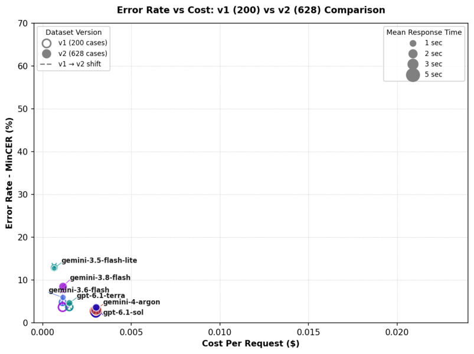
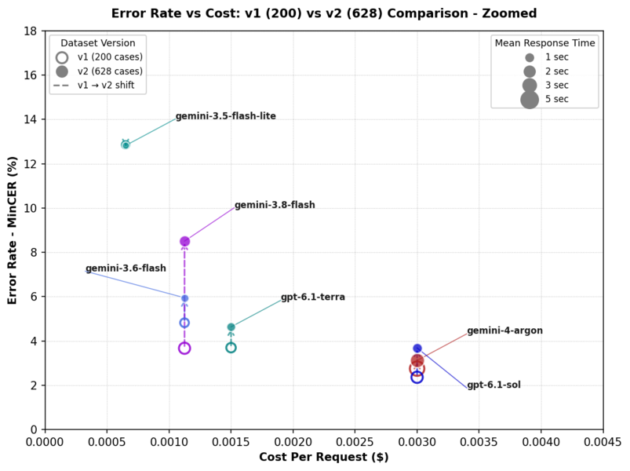
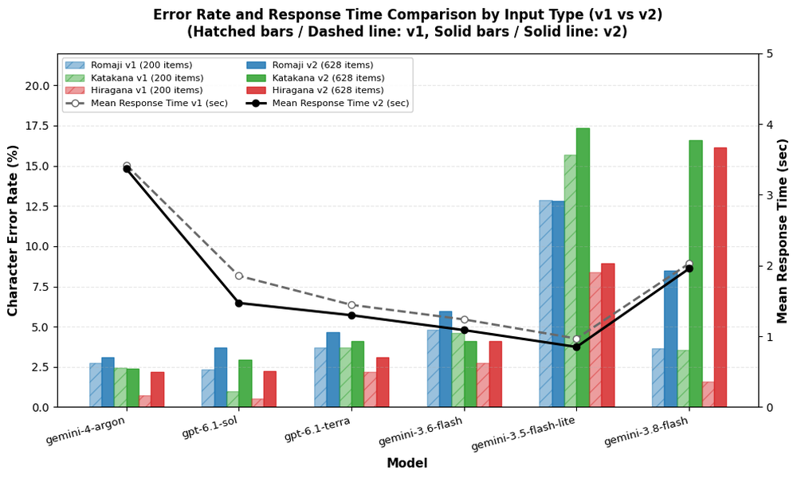
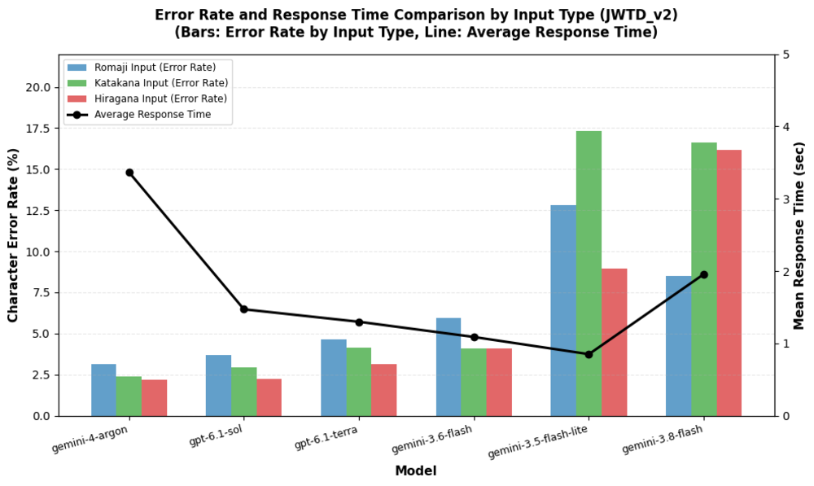
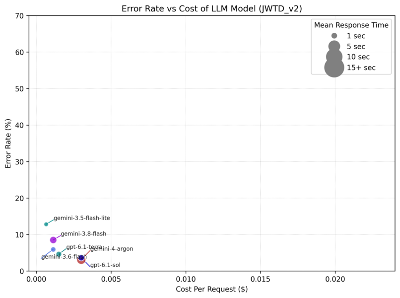
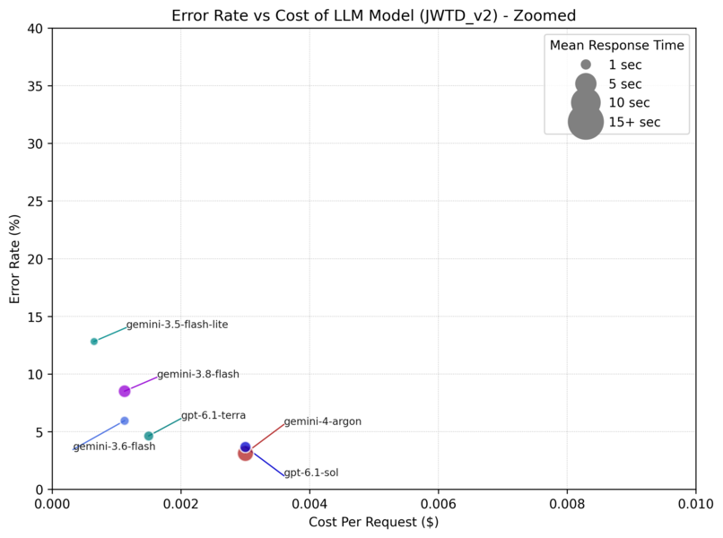
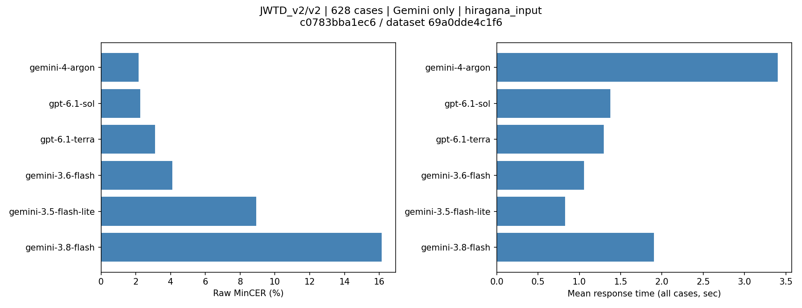
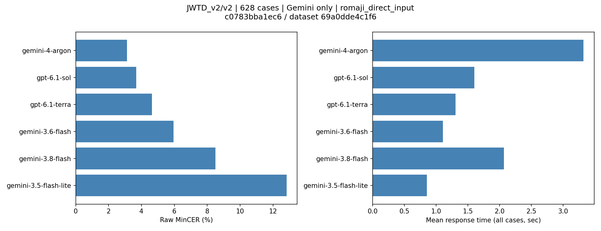
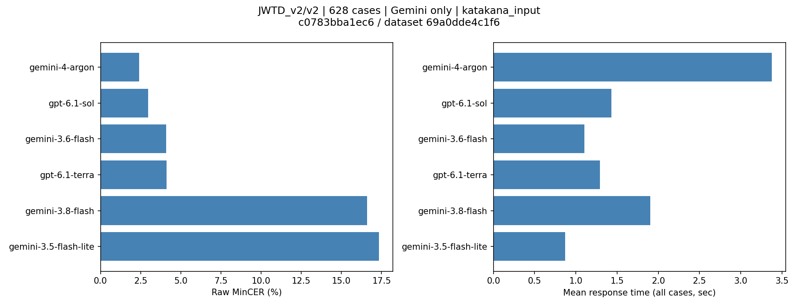

# JWTD_v2/v2・628件・GeminiおよびGPT比較 — 計測結果

## 結論

Gemini 4モデル（3.5 Flash-Lite・3.6 Flash・3.8 Flash・4 Argon）およびOpenAI 2モデル（GPT-6.1 Terra・GPT-6.1 Sol）の3入力方式全件計測（各628件×3方式＋ウォームアップ＝各1,890回、計11,340回）が完了した。

- **精度最上位**: **Gemini 4 Argon**（ローマ字3.12%、ひらがな2.17%、カタカナ2.40%）と **GPT-6.1 Sol**（ローマ字3.68%、ひらがな2.25%、カタカナ2.96%）が全モデル中トップクラスの低エラー率・高完全一致率を記録した。
- **実用性（速度＋精度）最優秀**: **GPT-6.1 Sol** は 4 Argon に迫る高精度を達成しながら、全件平均応答時間が **1.377〜1.602秒**（中央値 1.28〜1.49秒）と、Argon（3.32〜3.40秒）の半分以下の時間で応答した。Sumibiが実用条件とする「応答時間2秒以内」を完全にクリアしており、実環境での快適性と高精度を最も高水準で両立している。
- **コスト・速度・精度のベストバランス**: **GPT-6.1 Terra** は全件平均応答時間 **1.293〜1.305秒**（中央値約1.25秒）、MinCER 3.12〜4.63% と極めて軽快かつ安定しており、参考費用も全件で <strong>\$1.16</strong> と、Sol（\$2.51）や Argon（\$1.90）の約半額で利用できる。
- **3.8 Flash の課題**: 3.8 Flash では「説明・候補列挙が付いた長文出力」が発生し、完全一致率は高いものの平均MinCERが8.51%〜16.60%と大幅に悪化した。4 Argon や GPT系モデルではこの現象は発生せず、安定した変換結果が得られた。
- **コスト最安**: **Gemini 3.5 Flash-Lite**（\$0.28、0.83〜0.87秒）だが、MinCERは8.93%〜17.34%と高い。
- **Gemini 3.6 Flash**: 1.05〜1.11秒、\$0.64、MinCER 4.10%〜5.95% と、Gemini Flash系の中で最もバランスが取れている。

なお、その他の古いGeminiモデル（2.5系、3-flash-preview、提供終了済みモデル等）および3.8へ自動転送される3.7 Flashについては、旧世代モデルのためユーザー指示により計測不要として今回のベンチマーク対象外とした。

旧v1のランキングやスコアとは混ぜない。計測時刻とモデル固有の推論条件は異なるため、同時刻・同じ思考量の厳密な統制実験とはしない。

### v2全628件・6モデル比較

| 入力方式 | モデル | MinCER | 完全一致率 | 全件平均 |
|---|---|---:|---:|---:|
| ローマ字 | 3.5 Flash-Lite | 12.82% | 37.42% | 0.851秒 |
| ローマ字 | 3.6 Flash | 5.95% | 55.10% | 1.106秒 |
| ローマ字 | 3.8 Flash | 8.51% | 67.99% | 2.068秒 |
| ローマ字 | 4 Argon | 3.12% | 74.84% | 3.321秒 |
| ローマ字 | GPT-6.1 Terra | 4.63% | 61.15% | 1.305秒 |
| ローマ字 | GPT-6.1 Sol | 3.68% | 69.11% | 1.602秒 |
| ひらがな | 3.5 Flash-Lite | 8.93% | 53.50% | 0.828秒 |
| ひらがな | 3.6 Flash | 4.11% | 66.08% | 1.055秒 |
| ひらがな | 3.8 Flash | 16.15% | 77.39% | 1.902秒 |
| ひらがな | 4 Argon | 2.17% | 81.85% | 3.401秒 |
| ひらがな | GPT-6.1 Terra | 3.12% | 73.89% | 1.297秒 |
| ひらがな | GPT-6.1 Sol | 2.25% | 80.57% | 1.377秒 |
| カタカナ | 3.5 Flash-Lite | 17.34% | 45.86% | 0.870秒 |
| カタカナ | 3.6 Flash | 4.10% | 65.29% | 1.103秒 |
| カタカナ | 3.8 Flash | 16.60% | 75.16% | 1.900秒 |
| カタカナ | 4 Argon | 2.40% | 81.05% | 3.379秒 |
| カタカナ | GPT-6.1 Terra | 4.12% | 66.88% | 1.293秒 |
| カタカナ | GPT-6.1 Sol | 2.96% | 78.34% | 1.433秒 |

[6モデルの集計JSON](summary-6models.json)に全統計・タグ・domain・出典別の内訳を保存した。[4モデル集計](summary-4models.json)、[3モデル集計](summary-3models.json)、[2モデル集計](summary-2models.json)、[単モデル集計](summary.json)も保持している。

## GPT-6.1 Sol の詳細

2026-11-01 16:33:48〜17:22:13（日本時間）に全1,890回を実行。HTTPエラー0・途中再開なしで完走した。返却モデルは全件`gpt-6.1-sol`。OpenAI公式API、`reasoning_effort=low`、`verbosity=low`、temperature省略、SDK再試行0、タイムアウト120秒。

| 入力方式 | 完全一致 | 幅正規化完全一致率 | 中央値 | p95 | p95以下平均 | 最大 | ブロック／空出力 |
|---|---:|---:|---:|---:|---:|---:|---:|
| ローマ字 | 434/628 | 73.57% | 1.488秒 | 2.520秒 | 1.543秒 | 10.435秒 | 0 / 0 |
| ひらがな | 506/628 | 82.01% | 1.283秒 | 1.885秒 | 1.308秒 | 6.664秒 | 0 / 0 |
| カタカナ | 492/628 | 79.14% | 1.335秒 | 2.125秒 | 1.358秒 | 7.838秒 | 0 / 0 |

MinCERの95%信頼区間（seed=42、1,000リサンプル）:
- ローマ字: 3.12〜4.25%
- ひらがな: 1.83〜2.71%
- カタカナ: 2.29〜3.68%

### 出典別内訳（同じv2計測内）

| 入力方式 | v2内の旧版由来200件 MinCER / 完全一致率 | v2内の新規428件 MinCER / 完全一致率 |
|---|---:|---:|
| ローマ字 | 2.52% / 79.00% | 4.22% / 64.49% |
| ひらがな | 0.53% / 94.50% | 3.06% / 74.07% |
| カタカナ | 2.21% / 92.50% | 3.31% / 71.73% |

### 使用量と費用

本計測（全1,890回完走）の返却使用量は入力964,251・出力57,749・総数1,022,000トークン。トークン内訳不明差分は0、使用量未返却呼び出しは0。
本計測の参考費用は<strong>\$2.505992</strong>（評価分\$2.497202＋ウォームアップ\$0.008790）。
疎通確認9回（\$0.013730）を含めた計1,899回の合計は<strong>\$2.519722</strong>。

価格は入力\$2.00・キャッシュ入力\$0.10・出力\$10.00/100万トークンのStandard有料枠換算。

原本: [本計測](results/gpt-6.1-sol/full.json)／[疎通確認](results/gpt-6.1-sol/smoke.json)

## GPT-6.1 Terra の詳細

2026-11-01 15:44:09〜16:26:52（日本時間）に全1,890回を実行。HTTPエラー0・途中再開なしで完走した。返却モデルは全件`gpt-6.1-terra`。OpenAI公式API、`reasoning_effort=none`、`verbosity=low`、`service_tier=default`、temperature=1.0、SDK再試行0、タイムアウト120秒。

| 入力方式 | 完全一致 | 幅正規化完全一致率 | 中央値 | p95 | p95以下平均 | 最大 | ブロック／空出力 |
|---|---:|---:|---:|---:|---:|---:|---:|
| ローマ字 | 384/628 | 64.65% | 1.252秒 | 1.625秒 | 1.258秒 | 7.092秒 | 0 / 0 |
| ひらがな | 464/628 | 75.80% | 1.274秒 | 1.633秒 | 1.271秒 | 2.909秒 | 0 / 0 |
| カタカナ | 420/628 | 68.79% | 1.253秒 | 1.682秒 | 1.261秒 | 2.449秒 | 0 / 0 |

MinCERの95%信頼区間（seed=42、1,000リサンプル）:
- ローマ字: 4.00〜5.35%
- ひらがな: 2.55〜3.75%
- カタカナ: 3.39〜4.91%

### 出典別内訳（同じv2計測内）

| 入力方式 | v2内の旧版由来200件 MinCER / 完全一致率 | v2内の新規428件 MinCER / 完全一致率 |
|---|---:|---:|
| ローマ字 | 3.60% / 71.00% | 5.12% / 56.54% |
| ひらがな | 2.07% / 87.00% | 3.61% / 67.76% |
| カタカナ | 4.16% / 77.50% | 4.10% / 61.92% |

### 使用量と費用

本計測（全1,890回完走）の返却使用量は入力964,251・出力39,410・総数1,003,661トークン。トークン内訳不明差分は0、使用量未返却呼び出しは0。
本計測の参考費用は<strong>\$1.161301</strong>（評価分\$1.157161＋ウォームアップ\$0.004140）。
疎通確認9回（\$0.006210）を含めた計1,899回の合計は<strong>\$1.167511</strong>。

価格は入力\$1.00・キャッシュ入力\$0.05・出力\$5.00/100万トークンのStandard有料枠換算。

原本: [本計測](results/gpt-6.1-terra/full.json)／[疎通確認](results/gpt-6.1-terra/smoke.json)

## Gemini 4 Argonの詳細

2026-11-01 12:23:58〜14:11:25（日本時間）に最初から全1,890回を実行（全件再計測）。HTTPエラー0・途中再開なしで完走した。返却モデルは全件`gemini-4-argon`。`reasoning_effort=low`、temperature省略、SDK再試行0、タイムアウト120秒。左文脈・プロンプト・文字種変換・評価データは他モデルと同じ。

| 入力方式 | 完全一致 | 幅正規化完全一致率 | 中央値 | p95 | p95以下平均 | 最大 | ブロック／空出力 |
|---|---:|---:|---:|---:|---:|---:|---:|
| ローマ字 | 469/628 | 79.62% | 2.828秒 | 5.960秒 | 2.858秒 | 42.261秒 | 3 / 3 |
| ひらがな | 514/628 | 83.92% | 2.833秒 | 5.949秒 | 2.924秒 | 28.216秒 | 2 / 2 |
| カタカナ | 509/628 | 83.12% | 2.912秒 | 5.873秒 | 2.984秒 | 32.492秒 | 3 / 3 |

MinCERの95%信頼区間（seed=42、1,000リサンプル）:
- ローマ字: 2.48〜3.84%
- ひらがな: 1.63〜2.79%
- カタカナ: 1.79〜3.12%

### ブロックと空出力

ブロックは計8件発生した。finish_reasonはいずれも`content_filter: OTHER`で、空文字列として評価対象に含めている（ウォームアップのブロックはなし）。
- ローマ字: 106番（index 1595）、285番（index 3221）、317番（index 1037）
- ひらがな: 317番（index 1037）、329番（index 4709）
- カタカナ: 89番（index 1431）、174番（index 2018）、316番（index 3028）

### 出典別内訳（同じv2計測内）

| 入力方式 | v2内の旧版由来200件 MinCER / 完全一致率 | v2内の新規428件 MinCER / 完全一致率 |
|---|---:|---:|
| ローマ字 | 2.17% / 83.00% | 3.56% / 71.03% |
| ひらがな | 0.76% / 92.00% | 2.83% / 77.10% |
| カタカナ | 1.77% / 92.00% | 2.70% / 75.93% |

### 使用量と費用

本計測（全1,890回完走）の返却使用量は入力799,226・出力30,032・総数829,258トークン。トークン内訳不明差分は0、使用量未返却呼び出しは0。
本計測の参考費用は<strong>\$1.898772</strong>（評価分\$1.891964＋ウォームアップ\$0.006808）。

価格は導入期（〜2026-11-30）の入力\$2.00・キャッシュ入力\$0.20・出力\$10.00/100万トークンのStandard有料枠換算。税・為替・特典適用・実請求額とは区別する。

原本: [本計測（全件再計測）](results/gemini-4-argon/full-rerun.json)／[中断時の記録](results/gemini-4-argon/full.json)／[疎通確認](results/gemini-4-argon/smoke.json)

## Gemini 3.8 Flashの詳細

2026-11-01 10:15:37〜11:18:33（日本時間）に1,890回を実行、HTTPエラー0・途中再開なし。返却モデルは全件`gemini-3.8-flash`。`reasoning_effort=low`、temperature=1.0、SDK再試行0、タイムアウト120秒。左文脈・プロンプト・文字種変換・評価データは他モデルと同じ。

| 入力方式 | 完全一致 | 幅正規化完全一致率 | 中央値 | p95 | p95以下平均 | 最大 | ブロック／空出力 |
|---|---:|---:|---:|---:|---:|---:|---:|
| ローマ字 | 427/628 | 72.61% | 1.936秒 | 2.931秒 | 1.928秒 | 21.389秒 | 3 / 3 |
| ひらがな | 486/628 | 79.30% | 1.846秒 | 2.609秒 | 1.836秒 | 4.437秒 | 0 / 0 |
| カタカナ | 472/628 | 76.75% | 1.866秒 | 2.397秒 | 1.824秒 | 7.820秒 | 1 / 1 |

ブロックはローマ字69・174・263番、カタカナ246番。すべて評価対象で、空出力として精度に含めた。ウォームアップのブロックはない。

### 完全一致率と平均MinCERが逆の評価になる理由

返却された本文を確認すると、一部で説明・候補列挙・入力の再掲が付いていた。例えばひらがな254番（index=5116）は、正解が14文字のところ454文字の出力になり、項目MinCERは31.43（約3,143%）だった。ひらがな196番・478番も説明付き出力だった。内部推論の原因やAPI側の不具合とまでは断定しない。

CERは挿入文字が多いと100%を超える指標であり、計算エラーではない。628件中、項目MinCERが1（100%）を超えた件数はローマ字4件、ひらがな10件、カタカナ8件。ひらがなの最大3件だけで平均MinCERに約8.50ポイント寄与している。これらを除外・上限1に丸めたり、最後の一文だけを抜き出したりせず、そのまま評価した。

MinCERの95%信頼区間はローマ字4.19〜13.99%、ひらがな6.59〜29.30%、カタカナ5.44〜29.94%。少数の大きな誤りで区間も広くなっている。

### 使用量と参考費用

返却使用量は入力725,893・出力27,067・総数764,597トークン。99回で総数と入力＋出力の差があり、内訳不明差分は合計11,637トークン（負の差分0）だった。
入力・出力の既知内訳だけに基づく本計測の参考費用は<strong>\$0.645921</strong>（評価分\$0.643590＋ウォームアップ\$0.002331）。疎通9回\$0.0034965を加えると<strong>\$0.6494175</strong>。

原本: [本計測](results/gemini-3.8-flash/full.json)／[疎通確認](results/gemini-3.8-flash/smoke.json)

## Gemini 3.6 Flashの詳細

2026-11-01 06:29:18〜07:31:52（日本時間）に実行。ローマ字474件目でHTTP 503となり停止し、07:04:56に明示再開。最初の成功475回（評価473件＋ウォームアップ2回）は無変更で引き継ぎ、残り1,415回を実行した。

返却モデルは成功1,890回とも`gemini-3.6-flash`。`reasoning_effort=minimal`、temperature=1.0、SDK再試行0、タイムアウト120秒。

| 入力方式 | 完全一致 | 幅正規化完全一致率 | 中央値 | p95 | p95以下平均 | 最大 |
|---|---:|---:|---:|---:|---:|---:|
| ローマ字 | 346/628 | 58.76% | 1.013秒 | 1.467秒 | 1.025秒 | 24.700秒 |
| ひらがな | 415/628 | 67.83% | 1.029秒 | 1.282秒 | 1.028秒 | 2.809秒 |
| カタカナ | 410/628 | 66.56% | 1.063秒 | 1.379秒 | 1.058秒 | 4.861秒 |

MinCERの95%信頼区間はローマ字5.09〜6.91%、ひらがな3.45〜4.75%、カタカナ3.35〜4.89%。
成功した本計測の参考費用は<strong>\$0.6365835</strong>（評価分\$0.6342525＋ウォームアップ\$0.002331）、疎通9回\$0.0034965を加えると<strong>\$0.640080</strong>。

原本: [再開後の完走記録](results/gemini-3.6-flash/full-resumed.json)／[停止時の記録](results/gemini-3.6-flash/full.json)／[疎通確認](results/gemini-3.6-flash/smoke.json)

## Gemini 3.5 Flash-Liteの詳細

2026-10-31 22:18:05〜22:46:19（日本時間）に実行。返却モデルは全1,890回とも`gemini-3.5-flash-lite`。`reasoning_effort=minimal`、temperature省略、SDK再試行0、タイムアウト120秒。

| 入力方式 | MinCER | 完全一致 | 幅正規化完全一致率 | 全件平均 | 中央値 | p95 | p95以下平均 | 最大 |
|---|---:|---:|---:|---:|---:|---:|---:|---:|
| ローマ字 | 12.82% | 235/628（37.42%） | 40.45% | 0.851秒 | 0.803秒 | 1.213秒 | 0.827秒 | 1.655秒 |
| ひらがな | 8.93% | 336/628（53.50%） | 54.30% | 0.828秒 | 0.775秒 | 1.177秒 | 0.804秒 | 1.523秒 |
| カタカナ | 17.34% | 288/628（45.86%） | 46.34% | 0.870秒 | 0.808秒 | 1.246秒 | 0.830秒 | 9.028秒 |

MinCERのブートストラップ95%信頼区間:
- ローマ字: 11.33〜14.27%
- ひらがな: 7.53〜10.45%
- カタカナ: 14.81〜20.14%

成功した本計測の参考費用は<strong>\$0.2811704</strong>（評価分\$0.280112＋ウォームアップ\$0.0010584）、成功疎通9回\$0.0015876を加えると<strong>\$0.282758</strong>。

原本: [全件の原本・監査記録](results/gemini-3.5-flash-lite/full.json)／[成功した疎通](results/gemini-3.5-flash-lite/smoke2.json)

## データと計測条件

- 出典: [nyanko3141592/AJIMEE-Bench](https://github.com/nyanko3141592/AJIMEE-Bench/tree/c0783bba1ec6b9a9e06d07fa52ce3e23d0a7dfe1/JWTD_v2/v2)
- データ: `JWTD_v2/v2/evaluation_items.json`、628件（旧版由来200件＋新規428件）
- 上流SHA: `c0783bba1ec6b9a9e06d07fa52ce3e23d0a7dfe1`
- データSHA-256: `69a0dde4c1f67b3d06268c761ee3a7b7d38680a4f1c81360cc2d4f0f120e731f`
- エンドポイント:
  - Geminiモデル: `https://generativelanguage.googleapis.com/v1beta/openai/`
  - OpenAIモデル: `https://api.openai.com/v1/`
- 同じSumibiプロンプトで左文脈を使用。右文脈・正解・original_textは送信しない。
- 各方式628件。ウォームアップ各2回は品質・応答時間の集計から除外し、費用には含める。

---

## v1 vs v2 統合比較分析

旧版ベンチマーク（v1・200件）と新版ベンチマーク（v2・628件）の両方で計測されたモデルについて、データセットの拡張に伴うエラー率とコストの推移を1つのグラフに統合しました。

- **表示の工夫**:
  - **v1（旧版 200件）**: 実線ボーダー・中空サークル（白抜き）
  - **v2（新版 628件）**: 実線ボーダー・塗りつぶしサークル
  - 同一モデルは同系色とし、v1からv2への推移を薄い矢印（`v1 → v2 shift`）で繋いでいます。
  - バブルの大きさは各モデルの平均応答時間を示します。

### エラー率 vs コスト（v1 vs v2 比較・1000x600 バブルチャート）

### エラー率 vs コスト（v1 vs v2 拡大図・実用コスト帯）

### 入力タイプ別エラー率と応答時間（v1 vs v2 比較・1000x600 棒グラフ＋折れ線）

### v1 vs v2 比較の主な示唆
1. **データセット拡張による難易度上昇**:
   新規428件が追加されたv2では、口語表現・同音異義語・数字表記等の多様なケースが含まれており、ほとんどのモデルでv1時よりCERが上昇しています。
2. **Gemini 3.8 Flash の急激な悪化**:
   v1ではCER 3.67%と良好だった3.8 Flashが、v2では8.51%へと大幅に悪化しました。長文や多様なコンテキストにおいて説明・候補列挙を出力してしまう傾向が顕在化したためです。
3. **最新世代の圧倒的安定性**:
   新世代の **GPT-6.1 Sol**（CER 3.68%）および **Gemini 4 Argon**（CER 3.12%）は、難化したv2データセットにおいても極めて低いエラー率を維持しています。
4. **入力タイプ別の頑健性と応答時間**:
   - **ひらがな入力の優位性**: 全モデル共通で「ひらがな入力」が最も低いエラー率を示しました（Argon: 0.75% → 2.17%、Sol: 0.55% → 2.25%、Terra: 2.20% → 3.12%）。
   - **カタカナ・ローマ字における顕著な差**: v2の新規428件において、3.8 Flashはカタカナ（3.54% → 16.60%）とひらがな（1.57% → 16.15%）の双方で解説や候補列挙の混入による急激な悪化が見られたのに対し、4 Argon（2.40%〜3.12%）や GPT-6.1 Sol（2.25%〜3.68%）は入力タイプを問わずv1からv2にかけて極めて安定した低エラー率を維持しました。
   - **応答時間の維持・短縮**: v1からv2にかけて各社APIの最適化もあり、多くのモデル（特に GPT-6.1 Sol: 1.86秒 → 1.47秒）で応答時間が維持または短縮傾向にあります。

---

## v2専用グラフ（6モデル比較）

取得済み全6モデルを比較したv2専用の可視化グラフです。

### 入力タイプ別エラー率と応答時間（1000x600 棒グラフ＋折れ線）
v1の `images/plot_errorrate_vs_inputtype_1000x600.png` と同様の形式（棒グラフ: 入力方式別CER、折れ線: 平均レスポンス時間）で描画したグラフです。

### エラー率 vs コスト（1000x600 バブルチャート）
v1の `images/plot_errorrate_vs_cost_1000x600.png` と同様の形式（X軸: コスト、Y軸: エラー率/MinCER、円サイズ: 平均応答時間）で描画したグラフです。

### 入力方式別のMinCER・平均応答時間

---

## 原本・再現

- [6モデル集計JSON](summary-6models.json)
- [4モデル集計JSON](summary-4models.json)
- [3モデル集計JSON](summary-3models.json)
- [GPT-6.1 Sol 原本](results/gpt-6.1-sol/full.json)／[疎通確認](results/gpt-6.1-sol/smoke.json)
- [GPT-6.1 Terra 原本](results/gpt-6.1-terra/full.json)／[疎通確認](results/gpt-6.1-terra/smoke.json)
- [Gemini 4 Argon 原本](results/gemini-4-argon/full-rerun.json)／[疎通確認](results/gemini-4-argon/smoke.json)
- [Gemini 3.8 Flash 原本](results/gemini-3.8-flash/full.json)／[疎通確認](results/gemini-3.8-flash/smoke.json)
- [Gemini 3.6 Flash 原本](results/gemini-3.6-flash/full-resumed.json)／[疎通確認](results/gemini-3.6-flash/smoke.json)
- [Gemini 3.5 Flash-Lite 原本](results/gemini-3.5-flash-lite/full.json)／[疎通確認](results/gemini-3.5-flash-lite/smoke2.json)
- [固定データ・ハッシュ・ライセンス](dataset.json)
- [実行・集計・描画手順](README.md)
