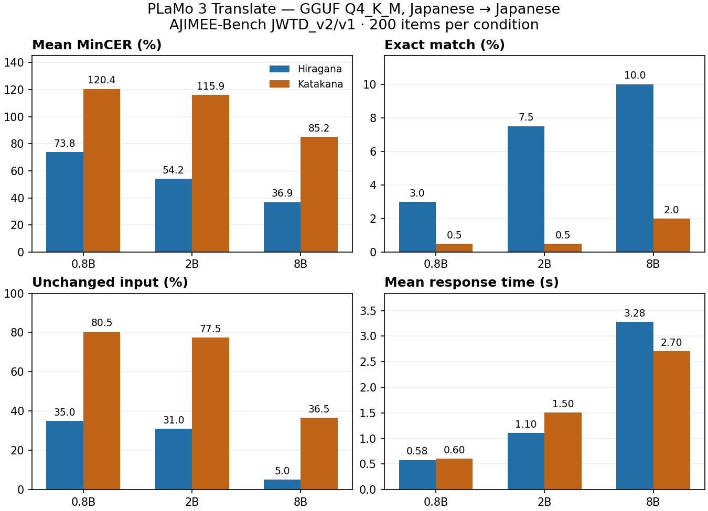
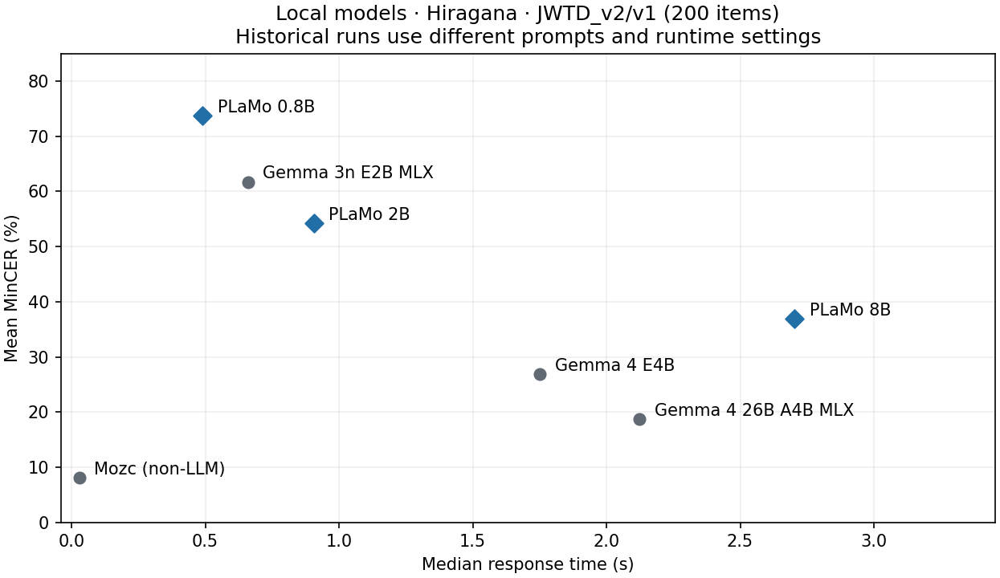

# PLaMo 3 Translate 0.8B・2B・8Bのローカルかな漢字変換（Issue #209）

2026-11-11〜12、macOSのLM Studioで公式GGUF版の0.8B・2B・8Bを、ひらがな・カタカナ各200件で計測した。ひらがなの平均MinCERは73.76% → 54.19% → 36.87%と改善したが、8Bの完全一致は20/200件（10.0%）、平均応答は3.281秒だった。カタカナでも8Bで改善したが、ひらがなより誤りが多い。今回の条件では、サイズ増加で精度は上がるものの、8BでもSumibiの常用変換には精度・待ち時間の両面で課題が残る。31Bは未計測。



### 既存ローカルモデルとの参考比較（ひらがな）



既存結果は許容解と評価順が同じ200件であることを確認し、全件のMinCER（100%で打ち切らない）と応答時間の中央値を再集計した。PLaMoとはプロンプト・ランタイム等の条件が異なるため参考比較。既存の全モデルグラフはCERの上限や応答時間の集計方法が異なり、今回の数値は混ぜていない。

## 計測条件

- モデル: [0.8B GGUF](https://huggingface.co/pfnet/plamo-3-translate-0.8b-GGUF)・[2B GGUF](https://huggingface.co/pfnet/plamo-3-translate-2b-GGUF)・[8B GGUF](https://huggingface.co/pfnet/plamo-3-translate-8b-GGUF) の `Q4_K_M`。API IDはそれぞれ `plamo-3-translate-0.8b`、`plamo-3-translate-2b`、`plamo-3-translate-8b`。
- 0.8Bの重み: `plamo-3-translate-0.8b-Q4_K_M.gguf`、573,126,848バイト、SHA-256 `70891ec70dc7ab4205745a38307867c2881b99239f20327927633abfe4bc9ec6`。
- 2Bの重み: `plamo-3-translate-2b-Q4_K_M.gguf`、1,807,203,040バイト、SHA-256 `1ffd9073afcc70e35ccc942428aa2b73d7aa2b9ea779bf504b775369e0276c13`。配布リビジョンと推論中のメモリ使用量は未確認。ファイルサイズはメモリ使用量ではない。
- 8Bの重み: `plamo-3-translate-8b-Q4_K_M.gguf`、5,280,445,728バイト、SHA-256 `94e5d3f91b421f7c8900ddaac27b11a19f7441426c954bbb25a2fd60a1640187`。
- Apple M4・24 GiB、macOS 27.0.1、LM Studio `0.4.28+2`、選択中のGGUFランタイム `llama.cpp-mac-arm64-apple-metal-advsimd@2.73.0`、コンテキスト長8192。
- [AJIMEE-Bench](https://github.com/azooKey/AJIMEE-Bench)の `JWTD_v2/v1/evaluation_items.json`、各条件200件。SHA-256 `e9eb668fd6aa14b1e26436f429b5550108af0a1dfd443b8cea0bcb3ab3028fca`。ひらがなでは既存の変換器を使い、カタカナではデータセットの原文をそのまま使う。別版の628件とは混ぜていない。
- `[plamo-translate]` のシステムメッセージで `source_lang=ja`、`target_lang=ja` を指定。ユーザーメッセージは変換対象の原文のみ。左文脈のある100件は公式形式の `---` の後に文脈を渡した。通常のSumibiプロンプトとは形式が異なる。
- `temperature=0`、出力上限256トークン、停止文字列 `<|plamo:tag|>` / `<|plamo:bos|>`。リクエストは1件ずつ、`127.0.0.1:1234` のみ。APIキー、クラウド推論、自動再試行なし。
- モデルは事前ロード済み。各条件のウォームアップ2回を除外。応答時間はローカルHTTPリクエストから応答本文を受信するまでで、モデル読み込み時間を含まない。
- 8Bはひらがな→カタカナの順に計測。0.8Bのカタカナ計測時と8Bの計測時には2Bもロードされていたが、同時にリクエストは送っていない。速度はこの実行条件での観測値。

## ひらがな入力の結果

| 指標 | 0.8B | 2B | 8B |
|---|---:|---:|---:|
| 完了 | 200/200 | 200/200 | 200/200 |
| 平均MinCER | 73.76% | 54.19% | 36.87% |
| 完全一致 | 6/200（3.0%） | 15/200（7.5%） | 20/200（10.0%） |
| 入力をそのまま返した件数 | 70/200（35.0%） | 62/200（31.0%） | 10/200（5.0%） |
| 平均 / 中央値 | 0.580秒 / 0.490秒 | 1.103秒 / 0.905秒 | 3.281秒 / 2.703秒 |
| p95（nearest-rank）/ 最大 | 1.248秒 / 2.448秒 | 2.357秒 / 3.452秒 | 7.275秒 / 11.750秒 |
| 空出力 / HTTPエラー / 出力上限到達 | 0 / 0 / 0 | 0 / 0 / 0 | 0 / 0 / 0 |

## カタカナ入力の結果

| 指標 | 0.8B | 2B | 8B |
|---|---:|---:|---:|
| 完了 | 200/200 | 200/200 | 200/200 |
| 平均MinCER | 120.43% | 115.92% | 85.16% |
| 完全一致 | 1/200（0.5%） | 1/200（0.5%） | 4/200（2.0%） |
| 入力をそのまま返した件数 | 161/200（80.5%） | 155/200（77.5%） | 73/200（36.5%） |
| 平均 / 中央値 | 0.603秒 / 0.480秒 | 1.504秒 / 1.265秒 | 2.705秒 / 2.260秒 |
| p95（nearest-rank）/ 最大 | 1.358秒 / 2.410秒 | 3.310秒 / 5.350秒 | 6.015秒 / 10.803秒 |
| 空出力 / HTTPエラー / 出力上限到達 | 0 / 0 / 0 | 0 / 0 / 0 | 0 / 0 / 0 |

カタカナの読みをそのまま返すと、漢字交じりの正解より文字数が多くなる場合がある。CERは正解の文字数で編集距離を割るため、置換に加えて余分な文字があると100%を超える。採点結果に上限は設けていない。

採点では前後の空白だけを除き、原文のコピーや言い換えもそのまま集計した。MinCERは各入力で複数の許容解に対する文字誤り率の最小値を取り、その値を200件で平均したもの。正解の抽出、幅の正規化、説明の除去はしていない。

手動確認では `きょうはえきでともだちにあいました。` → `今日は駅で友達に会いました。` と変換できた一方、`はしでごはんをたべました。` → `橋でごはんを食べました。` となった。全件計測でも、原文のコピーに加えて「せんこう」を「先取り」と言い換える例や、末尾の語が落ちる例があった。手動の成功例だけでは、かな漢字変換に必要な原文保持や同音異義語の選択精度は判断できない。

先行確認では公式0.8B・2BのMLX版はLM Studioで付属Pythonコードの読み込みがブロックされた。GGUF版は計測した3サイズともロードに成功。出力言語の既定設定では指示文ごと英訳されたため、全件計測は上記の日本語→日本語設定に固定した。

## 再現

LM Studioで該当モデルを読み込み、ローカルサーバーを開始してからリポジトリルートで実行する。`Levenshtein` は既存ベンチマークと同じ依存。出力は未使用のパスを指定する。

```sh
python3 benchmark/run_plamo_local.py --model plamo-3-translate-0.8b --mode hiragana_input --output benchmark/issue209/plamo-0.8b-hiragana-repeat.jsonl
python3 benchmark/run_plamo_local.py --model plamo-3-translate-2b --mode katakana_input --output benchmark/issue209/plamo-2b-katakana-repeat.jsonl
python3 benchmark/plot_plamo_local.py
python3 -m unittest discover -s benchmark -p 'test_*.py'
```

グラフの再生成には `matplotlib` が必要。保存済みログと既存結果だけを読み、APIは呼び出さない。

ひらがなの記録: [0.8B疎通5件](plamo-0.8b-smoke.jsonl)／[0.8B全200件](plamo-0.8b-full.jsonl)／[2B全200件](plamo-2b-full.jsonl)／[8B全200件](plamo-8b-full.jsonl)。JSONLの先頭に条件、末尾に集計があり、ウォームアップと評価結果を区別している。モデル重みは含めていない。

カタカナの記録: [0.8B全200件](plamo-0.8b-katakana-full.jsonl)／[2B全200件](plamo-2b-katakana-full.jsonl)／[8B全200件](plamo-8b-katakana-full.jsonl)。6条件とも評価位置・項目ID・入力・許容解が固定データと一致し、保存済み集計を再計算して確認した。
